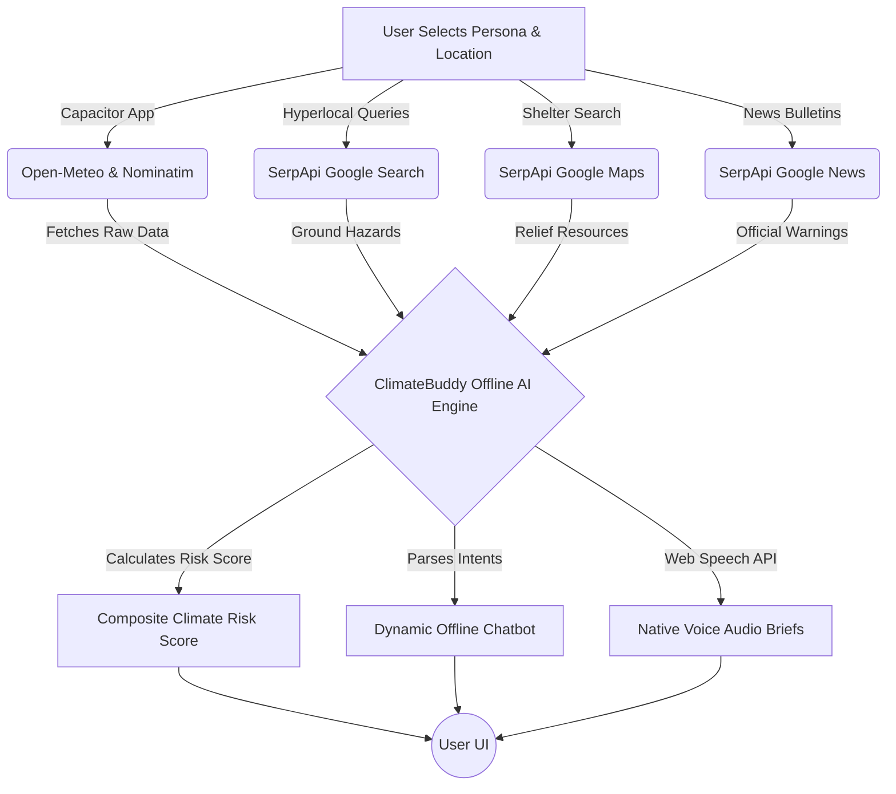
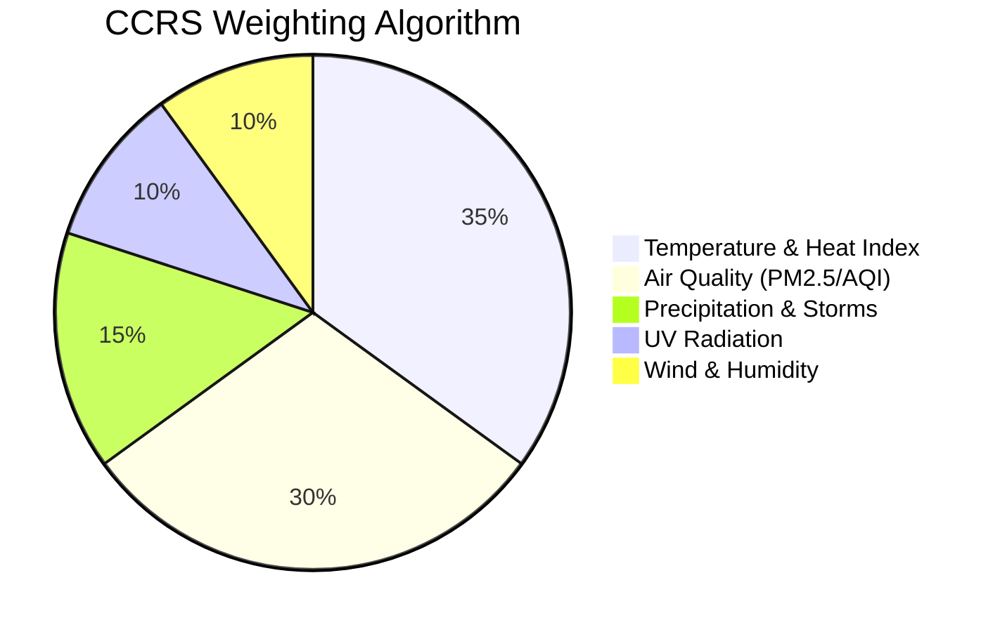

<div align="center">
  <div style="font-size: 70px; margin-bottom: 20px;">🌍</div>
  <h1 style="font-size: 3.5em; margin-bottom: 0;">ClimateBuddy</h1>
  <h2 style="font-size: 1.8em; font-weight: normal; margin-top: 5px; color: #f97316;">The AI Climate Copilot</h2>
  <p style="font-size: 1.2em; max-width: 800px; margin: 0 auto; line-height: 1.6;">
    <strong>Transforming raw meteorological data into hyper-personalized, actionable, and life-saving decisions for everyday people.</strong>
  </p>
</div>

<br />

> [!TIP]
> **Presenter Note:** Start your pitch by asking the audience: *"When you check a weather app and it says 35°C with an AQI of 150... what does that actually mean you should do? Most apps give you data. ClimateBuddy gives you decisions."*

---

## 🏆 Hackathon Submission: SerpApi Integrations
> [!IMPORTANT]
> **To the Evaluators:** This project is submitted under **Track 05 Impact: Knowledge & Public Interest**. 

ClimateBuddy leverages **SerpApi** as the central intelligence engine that grounds our AI’s mathematical models in **real-time, hyperlocal reality**. Without SerpApi, our AI would be guessing based on satellite models. With SerpApi, we pull live ground truth. 

We utilize SerpApi to power **four distinct Live Intelligence Tasks**:
1. 🚨 **Area Hazard & Waterlog Radar (SerpApi Google Search):** Dynamically scrapes hyperlocal municipal reports and civic news for immediate ground hazards (e.g., localized waterlogging, downed power lines) that standard radar cannot see.
2. 💧 **Relief & Resource Finder (SerpApi Google Maps/Places):** Instantly locates the nearest public drinking water kiosks, cooling shelters, and emergency hospitals relative to the user's coordinates during extreme heatwaves.
3. 🌤️ **Google Weather Knowledge Graph (SerpApi Google Weather):** Cross-references our Open-Meteo satellite models against the Google Weather Knowledge Graph to verify ground-truth consensus on temperature and precipitation.
4. 📰 **Breaking Climate News Bulletins (SerpApi Google News):** Aggregates the latest IMD (Indian Meteorological Department) and climate bulletins into a real-time feed, ensuring access to official disaster warnings instantly.

---

## 🚀 1. The Vision & The Problem

We are facing a global climate crisis. Extreme heatwaves, unpredictable rainfall, and severe air pollution are becoming daily realities. 

**The Problem with Current Solutions:**
1. **Data Overload:** Standard weather apps provide raw numbers (Humidity %, PM2.5, UV Index) but expect the user to be a meteorologist to understand them.
2. **One-Size-Fits-All:** A 35°C day is a minor inconvenience for an office worker in an air-conditioned car, but it is a **life-threatening hazard** for a delivery rider or a farmer.
3. **Accessibility:** Cloud-based AI chatbots require expensive API calls, constant high-speed internet, and literacy to use—excluding the rural and gig-economy workers who need climate advice the most.

**The ClimateBuddy Solution:**
ClimateBuddy is a locally-running, context-aware AI wrapper for climate data. It knows *who* you are, it pulls the exact climate data for *where* you are, and it uses a proprietary offline engine to tell you exactly *what* to do.

---

## 🧠 2. Core Architecture & Offline AI Engine

How does ClimateBuddy work without a backend server? 



### 🤖 The "Ask ClimateBuddy" Offline Engine
> [!IMPORTANT]
> **How it works:** We completely removed the reliance on expensive Cloud LLMs (like ChatGPT). Instead, we built a **Smart Logic Engine** directly into the React frontend. 

When a user asks: *"Should I water my crops today?"*
1. **Intent Recognition:** The engine detects keywords (`water`, `crop`, `irrigate`).
2. **Data Injection:** It checks the live variables: `Rain Probability = 75%`, `Soil Moisture = 60%`, `Wind Speed = 25km/h`.
3. **Dynamic Response Generation:** It constructs a mathematically driven response instantly: 
   *"Skip watering today—75% rain expected! Also, wind is high (25km/h), so if you must irrigate, use a drip system, not sprinklers."*

### ✨ UI Animations & Neumorphic Design
We built the app using **Neumorphism (Soft UI)** with a Tailwind Slate Dark Mode (`#0f172a`). 
* **Tactile Depth:** Elements aren't just flat colored boxes. We use complex CSS dual-shadows (light top-left, dark bottom-right) to make buttons look physically extruded from the screen.
* **Fluid Animations:** Powered by `framer-motion` and `lucide-react`, icons spin, cards glide into view, and buttons compress when tapped, giving the user a highly responsive, premium, "living" interface.
* **Why this matters:** A premium, animated, tactile UI builds *trust*. When an app looks professional and responsive, users are more likely to trust the critical safety data it provides.

---

## 👥 3. Real-World Use Cases (Who it Helps)

ClimateBuddy uses **Dynamic Personas**. The entire app shifts its advice based on the user's selected profile. 

| Persona | The Climate Threat | How ClimateBuddy Solves It |
| :--- | :--- | :--- |
| 🌾 **The Farmer** | Evaporation loss, unexpected rain washing away fertilizer. | App alerts them to high evaporation rates (advising pre-8 AM watering) and warns them to halt irrigation if precipitation is >60% likely, saving groundwater. |
| 🛵 **The Gig Worker** | Heatstroke, dehydration, PM2.5 exposure on roads. | App calculates "Safe Windows" for riding. If temp > 35°C, it nudges them to carry 2L of water and take mandated shade breaks every 45 minutes. |
| 🚲 **The Commuter** | Rain ruining clothes, peak traffic pollution. | Warns about high UV indexes (recommending SPF 50+) and advises wearing an N95 mask if the morning AQI exceeds 150. |
| 👨‍👩‍👧 **The Family** | Child respiratory issues, indoor heat trapping. | Recommends keeping children indoors between 11 AM - 3 PM on high-risk days and advises on cross-ventilation times. |

---

## 🔊 4. Accessibility First (The Voice Feature)

> [!NOTE]
> **Presenter Highlight:** This is a killer feature for rural and on-the-go demographics.

Not everyone can read a screen while working. ClimateBuddy utilizes the native **Android Web Speech API** to synthesize text-to-speech *on the device itself*.
* **How it's used:** A user taps the "Speak" button. The app instantly reads out the daily safety brief (e.g., *"Extreme heat today. Carry water. Avoid working between 12 and 3 PM."*)
* **Why it's useful:** A delivery driver can listen to their safety brief through their helmet Bluetooth while driving. A farmer with dirty hands doesn't need to scroll through a screen to know the day's forecast.

---

## 🛡️ 5. The Composite Climate Risk Score (CCRS)

We aggregate 5 complex metrics into **One Number (1-10)**.



* **Score 1-4 (Safe):** Go about your day normally.
* **Score 5-7 (Moderate Risk):** "Wear a mask today" or "Carry an umbrella."
* **Score 8-10 (Extreme Hazard):** "STAY INDOORS. Life-threatening heatwave."

This gamifies and simplifies environmental science so a 10-year-old or an 80-year-old can instantly understand their physical risk level before stepping outside.

---

## 📱 6. Technology Stack & Deployment

We built ClimateBuddy to be ultra-fast, lightweight, and deployable anywhere.

* **Frontend:** React 19 + Vite 8
* **Styling & Animation:** TailwindCSS v4 + Framer Motion
* **Mobile Wrapper:** Ionic Capacitor 8 (Generates the native Android APK)
* **Data Sources:** Open-Meteo (Aggregating IMD, Copernicus, Sentinel-5P) & Nominatim Geocoding.

**To build the Android APK:**
```bash
npm install
npm run cap:sync
npm run android:apk
```
*The resulting APK is only ~4.2 MB, making it accessible even on low-end smartphones with limited storage!*
